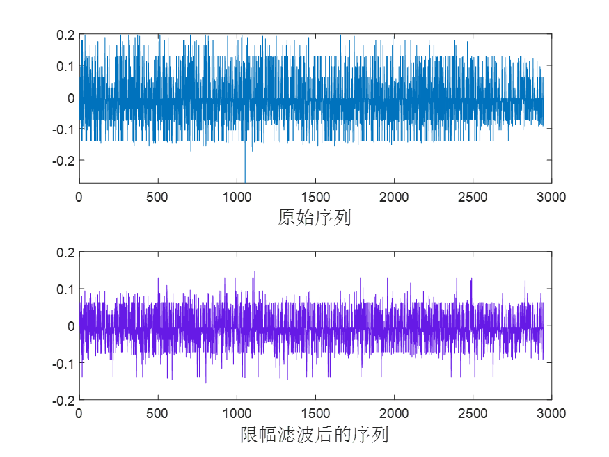
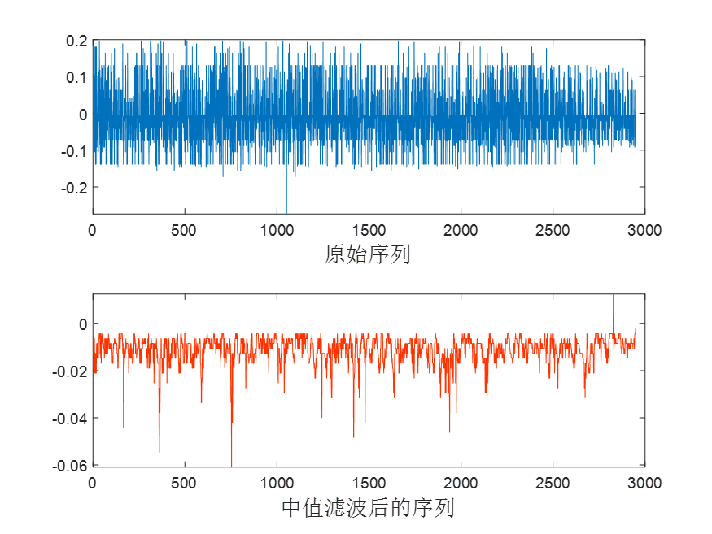
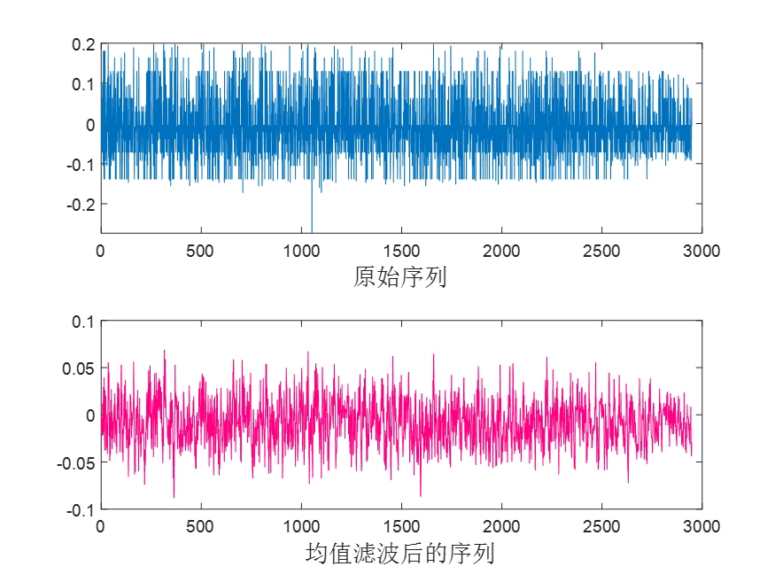
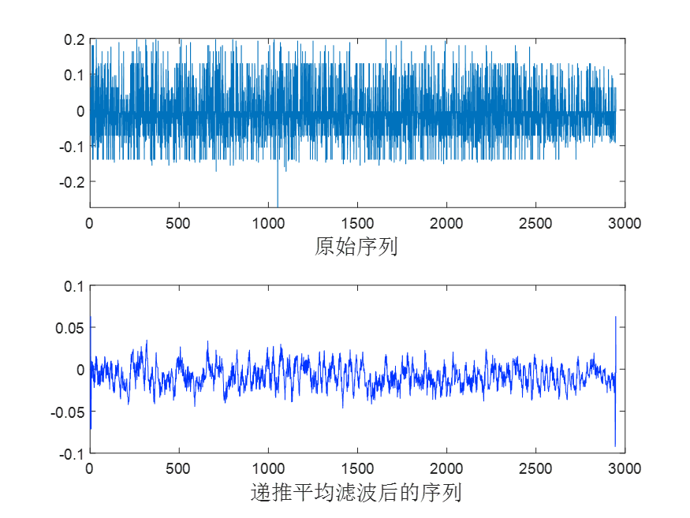
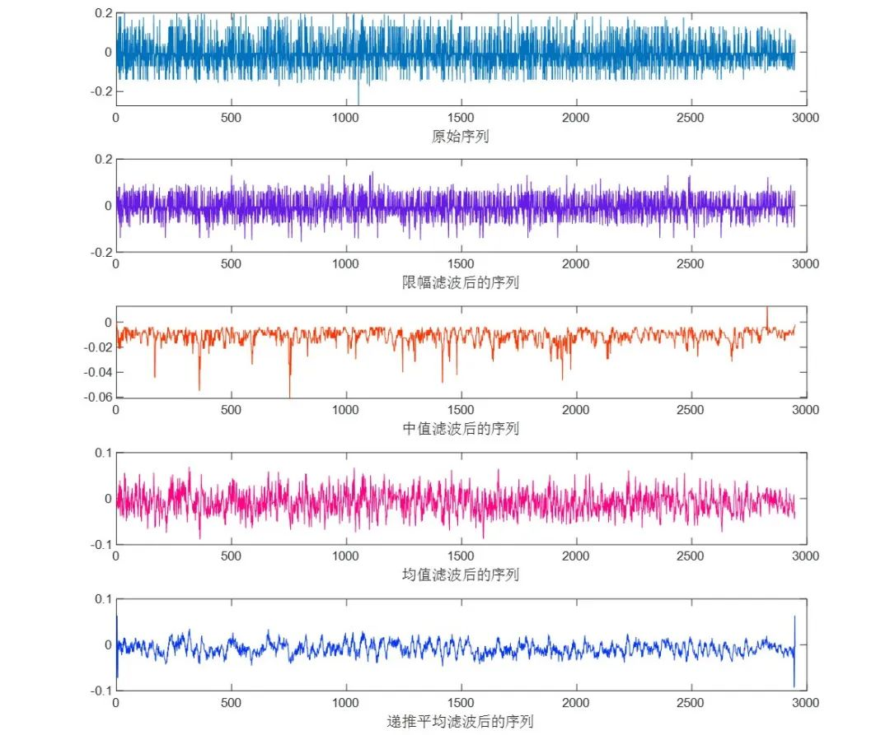
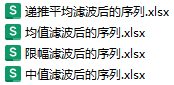

# 4 types of denoising and filtering methods! Band-limited filtering, median filtering, mean filtering, and recursive averaging filtering, directly run!

Applicable Platform: Matlab 2020 version and above
In practical applications, filtering and denoising are tools used for signal processing, typically in the preprocessing stage before machine learning/deep learning techniques. Their primary function is to smooth or remove noise from signals, thereby extracting useful information from the signal or improving the quality of the signal, thus enhancing the performance of fault identification. They are crucial for processing non-stationary signals and rapidly changing faults. Below, we introduce four types of filtering and denoising methods:
Clipping Filtering: The principle of clipping filtering is to set a threshold to limit the range of signal changes. Signals that exceed the threshold are weakened or replaced with neighboring values.
Characteristics:
Advantages: Simple and easy to implement, effectively suppresses the impact of anomalies or noise interference on abnormal waveforms.
Disadvantages: May cause signal distortion when the signal changes drastically, and requires adjusting different thresholds for different signal characteristics, not suitable for all situations.
Application Scenarios: Suitable for signals containing obvious anomalies, outliers, or noise.
Median Filtering: Median filtering replaces each sample point in the signal with the middle value of the corresponding sampling window. This method has good suppression effects on anomalies and noise.
Characteristics:
Advantages: Can effectively remove salt-and-pepper noise and impulse noise from the signal, retaining edge features of the signal.
Disadvantages: Requires significant computational effort, may not perform well against continuous high-frequency noise, and the size of the filtering window needs to be appropriately chosen.
Application Scenarios: Suitable for removing salt-and-pepper noise and impulse noise such as non-Gaussian noise, such as image processing, speech signal processing, etc.
Mean Filtering: Mean filtering achieves filtering by calculating the neighborhood average of each sample point in the signal, used for smoothing signals and reducing noise.
Characteristics:
Advantages: Simple and easy to implement, has good filtering effects on Gaussian noise and white noise, can retain the overall trend of the signal.
Disadvantages: Effective against sharp peaks or impulse noise in the signal is poor, may lead to excessive smoothing of the signal and loss of detail information.
Application Scenario: Suitable for filtering Gaussian noise and white noise, such as signal smoothing and data preprocessing.
Recursive Moving Average Filter: A type of filter that obtains the output after filtering by averaging weighted continuous sampling data, offering rapid response and low storage requirements.
Features:
Advantages: It has good anti-interference capability and fast response characteristics, suitable for processing dynamically changing signals.
Disadvantages: In cases where the instantaneous changes in the signal are large, it may cause output delay and distortion.
Application Scenario: The combination of recursive moving average filter with sliding window and weighted averaging features can effectively suppress noise and interference while maintaining the dynamic characteristics of the signal, suitable for processing dynamically changing signals.
Result Analysis: Taking the above original signal as an example, comparing four filtering methods, the following conclusions are drawn:
Limiting Filtering: Limiting filtering limits the part of the signal exceeding a preset threshold to within the threshold range, leaving the rest unchanged. Therefore, the filtering result retains most of the signal's characteristics while weakening or replacing abnormal values or noise, making the signal overall more stable.
Median Filtering: Median filtering replaces each sample value with the middle value of the corresponding sampling window. This method can effectively remove salt-and-pepper noise and impulse noise, retaining the edge features of the signal, making the filtered signal smoother and less distorted.
Mean Filtering: Mean filtering smooths the signal by calculating the neighborhood mean of each sampling point. The filtering result smooths the signal while retaining its overall trend, but it may lose some detail information, especially not effective against sharp peaks or impulse noise.
Recursive Moving Average Filter: Recursive moving average filter obtains the output after filtering by averaging weighted continuous sampling data. Due to its recursive nature, the filtering result has rapid response and lower storage requirements, but it may cause output delay and distortion when the instantaneous changes in the signal are large, and its effect on high-frequency noise is inferior to other filtering methods.
In summary, each of the four filtering methods has its own characteristics. Clipping filters can effectively reduce or replace outliers or noise, median filters can preserve signal edge features, mean filters can smooth signals and reduce noise, and recursive average filters have fast response and low storage requirements. When selecting a filtering method, it is necessary to make a comprehensive comparison for selection.
The filtered signal is automatically written into an Excel table for convenient subsequent processing.
\n        \n  
Welcome interested friends to follow the editor. We will continue to push high-quality learning materials, articles, and code.

## Images

<!-- PAYMENT_BLOCK -->

## Get this dataset

- Payment link (Stripe): [Buy now](https://buy.stripe.com/3cs8yP7sY87d0vu9AB)
- Payment QR code: 

<!-- /PAYMENT_BLOCK -->
